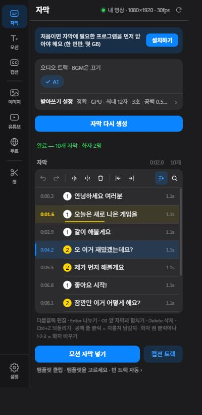
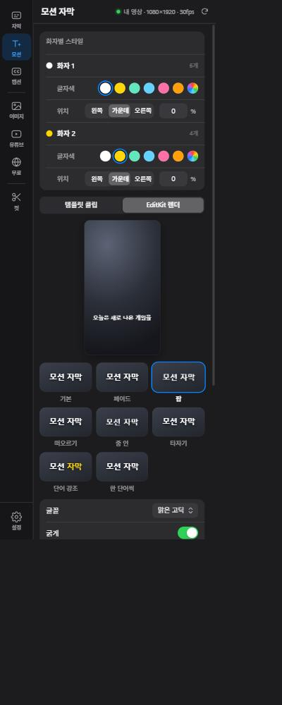
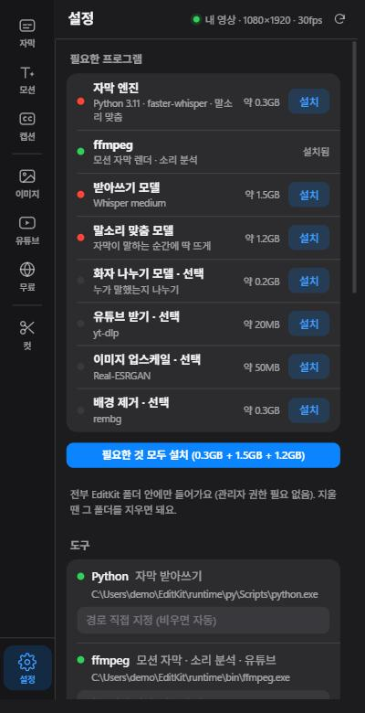

# EditKit 사용 가이드

EditKit은 프리미어 프로 안에서 쓰는 편집 도우미 패널이에요.
말을 받아써서 **자막을 자동으로 만들고**, 고친 자막을 **모션 자막·템플릿·캡션 트랙**으로 타임라인에 넣고, 영상에 쓸 **자료를 찾고**, **말 없는 구간을 잘라내** 줘요.

- [1. 설치](#1-설치)
- [2. 화면 둘러보기](#2-화면-둘러보기)
- [3. 자막 만들기](#3-자막-만들기)
- [4. 자막 고치기](#4-자막-고치기)
- [5. 화자 나누기](#5-화자-나누기)
- [6. 타임라인에 넣기 ① 모션 자막](#6-타임라인에-넣기--모션-자막)
- [7. 타임라인에 넣기 ② 캡션 트랙](#7-타임라인에-넣기--캡션-트랙)
- [8. 공백 · 무음 잘라내기](#8-공백--무음-잘라내기)
- [9. 자료 찾기](#9-자료-찾기)
- [10. 설정 · 업데이트](#10-설정--업데이트)
- [11. 단축키](#11-단축키)
- [12. 문제가 생기면](#12-문제가-생기면)
- [13. 지우기 · 라이선스](#13-지우기--라이선스)

---

## 1. 설치

**필요한 것**
- Windows 10 / 11 (64비트)
- Adobe Premiere Pro 2022 이상 (2026에서 확인)
- NVIDIA 그래픽카드 권장 — 없어도 되지만 자막 만들기가 느려요
- 디스크 여유 공간 약 6GB, 처음 한 번은 인터넷 연결

**순서**
1. [Releases](../../releases/latest)에서 `EditKit-<버전>-setup.zip`을 받아 압축을 **전부** 풀어요.
2. `EditKit 설치.bat`을 더블클릭해요.
   파란 "Windows의 PC 보호" 창이 뜨면 **추가 정보 → 실행**을 누르세요.
3. 프리미어 프로를 켜고 메뉴의 **창 → 확장 → EditKit**을 열어요.
4. 처음 열면 자막 페이지 맨 위에 **[설치하기]** 띠가 보여요. 누르면 자막에 필요한 프로그램과 모델을 받아요. (한 번만 하면 돼요)

| 받는 것 | 크기 | 쓰는 곳 |
|---|---|---|
| 자막 엔진 (Python 3.11 · faster-whisper) | 0.3GB, GPU가 있으면 +1GB | 받아쓰기 |
| ffmpeg | 0.1GB | 모션 자막 렌더 · 소리 분석 |
| 받아쓰기 모델 (Whisper) | 1.5~3GB | 받아쓰기 |
| 말소리 맞춤 모델 | 1.2GB | 자막이 말하는 순간에 딱 뜨게 |
| 화자 나누기 모델 · 선택 | 0.2GB | 누가 말했는지 나누기 |
| 유튜브 받기 · 업스케일 · 배경 제거 · 선택 | 각 20~300MB | 자료 페이지 |

> 전부 `%USERPROFILE%\EditKit` 폴더 안에만 들어가요. 관리자 권한은 필요 없고, 받다가 끊겨도 다시 누르면 이어서 받아요. 선택 항목은 **설정 → 필요한 프로그램**에서 따로 설치해요.

---

## 2. 화면 둘러보기

왼쪽 메뉴에서 페이지를 골라요. `Ctrl+1`~`Ctrl+8`로 위에서부터 바로 갈 수 있어요.

| 메뉴 | 하는 일 |
|---|---|
| **자막** | 받아쓰기 → 자막 목록에서 고치기 |
| **모션** | 모션 자막 · 템플릿으로 타임라인에 넣기, 화자별 스타일 |
| **캡션** | 프리미어 캡션 트랙(C1)으로 넣기 · SRT 저장 |
| **이미지 · 유튜브 · 무료** | 자료 검색 → 프로젝트·타임라인에 넣기 |
| **컷** | 말 없는 구간·무음 찾아서 잘라낸 새 시퀀스 만들기 |
| **설정** | 필요한 프로그램, 도구 경로, 렌더 옵션, 업데이트 |

작업이 돌아가는 동안 메뉴에 표시가 생기고, 다른 페이지에 있다가 끝나면 초록 점(실패하면 빨간 점)이 떠요.

---

## 3. 자막 만들기

1. 자막을 만들 **시퀀스를 프리미어에서 열어** 두세요.
2. **오디오 트랙**에서 말소리가 있는 트랙만 켜요. 배경음악(BGM) 트랙은 끄는 게 좋아요.
3. **[자막 생성]**을 눌러요. 끝나면 아래 목록에 자막이 줄줄이 나와요.

**받아쓰기 설정** (요약 줄을 누르면 펼쳐져요)

| 항목 | 설명 |
|---|---|
| 모델 | 정확 · GPU(기본) / 빠름 · GPU / CPU — 그래픽카드가 없으면 CPU |
| 언어 | 한국어 / English / 자동 감지 — 영어 영상은 English로 |
| 화자 나누기 | 끔 / 2명 / 3명 — [5. 화자 나누기](#5-화자-나누기) |
| 한 자막 최대 글자 | 한 화면에 나오는 글자 수 (기본 12, 영어는 같은 폭에 알파벳이 두 배쯤 들어가요) |
| 한 자막 최대 길이 | 한 자막이 화면에 머무는 최대 시간 (기본 3초) |
| 자막 타이밍 | 0 = 소리가 시작되는 순간. −면 먼저, +면 늦게 떠요. 바꾸면 전체 자막이 한 번에 옮겨져요 |
| 마침표·쉼표 빼기 | 켜면 문장부호를 지워요 (3.5 · don't 같은 건 그대로) |
| 공백으로 잡을 쉼 | 이만큼 말이 없으면 목록에 **공백** 줄로 표시 (기본 0.5초) |

> 자막은 문장 끝·쉼·쉼표에서 자연스럽게 나뉘고, "그 / 새 / 진짜"처럼 뒷말에 붙는 단어 뒤에서는 끊지 않아요. 글자 수나 길이 설정을 바꾸면 바로 다시 나눠져요. (고친 자막은 사라지니 확인 창이 떠요)

---

## 4. 자막 고치기

목록은 캡컷처럼 동작해요.

- **한 번 클릭** = 그 자막 선택 + 프리미어 재생헤드가 그 위치로 이동
- **두 번 클릭** = 그 글자 위치에서 바로 고치기
- **Shift/Ctrl+클릭** = 여러 개 선택, **Ctrl+A** = 전부

| 하고 싶은 것 | 방법 |
|---|---|
| 자막 나누기 | 고치는 중에 커서 위치에서 **Enter** (뒷부분은 아래 새 자막으로) |
| 앞 자막과 합치기 | 선택하고 **⌫**, 또는 고치는 중 글자 맨 앞에서 **⌫** |
| 뒤 자막과 합치기 | 고치는 중 글자 맨 끝에서 **Delete**, 또는 툴바 [합치기] |
| 자막 지우기 | 선택하고 **Delete** |
| 자막 안에서 줄바꿈 | **Shift+Enter** |
| 시작/끝을 지금 위치로 | 툴바의 ⇤ / ⇥ (프리미어 재생헤드 위치로 맞춰요) |
| 찾아 바꾸기 | **Ctrl+F** |
| 되돌리기 / 다시 | **Ctrl+Z** / **Ctrl+Shift+Z** |

- **재생 따라가기**(툴바 오른쪽 버튼): 프리미어에서 재생하면 지금 나오는 자막이 노랗게 표시되고 목록이 따라가요.
- **공백 줄**(주황): 말이 없는 구간이에요. 누르면 회색(남김)으로 바뀌고, 시간을 누르면 그 위치로 이동해요. 아래 **[공백 N곳 잘라내기]**를 누르면 주황 공백을 잘라낸 **새 시퀀스**를 만들고 자막도 거기에 맞춰 옮겨요. (원본 시퀀스는 그대로)
- 고친 자막은 자동으로 저장돼요. 패널을 닫았다 열어도 같은 시퀀스면 그대로 불러와요.

---

## 5. 화자 나누기

두세 명이 말하는 영상에서 **누가 말했는지 자막마다 표시**하고, 사람마다 **색·위치·템플릿**을 다르게 할 수 있어요.

1. 받아쓰기 설정 → **화자 나누기 2명**(또는 3명) → [자막 생성]
2. 자막마다 **번호 점**(①②)이 붙어요. 화자 1 = 먼저 말한 사람이에요.
3. 틀린 건 **점을 클릭**(다음 화자로)하거나, 자막을 선택하고 **1 · 2 · 3** 키를 누르면 바뀌어요.

> 목소리로 구분해서, 목소리가 많이 비슷하거나 아주 짧은 말("어", "아")은 가끔 틀려요. 화자 나누기 모델이 필요해요 (설정 → 필요한 프로그램).

**사람마다 스타일 정하기** — 모션 페이지 맨 위 **화자별 스타일** 카드
- 이름 (눌러서 바꾸기 — 예: "나", "친구")
- **EditKit 렌더**: 글자색 + 위치(왼쪽/가운데/오른쪽, 위아래 %)
- **템플릿 클립**: 화자마다 다른 템플릿 + 위치
- **캡션 트랙**: 화자마다 캡션 트랙이 따로 생겨요

---

## 6. 타임라인에 넣기 ① 모션 자막

자막 목록 아래 **[모션 자막 넣기]**를 누르면 모션 페이지에서 고른 방식으로 바로 들어가요. 오른쪽 작은 글씨(스타일 요약)를 누르면 모션 페이지로 가요.

### 방식 1 · 템플릿 클립 (프리미어에서 바로 고칠 수 있어요)

자막 하나하나가 **진짜 프리미어 텍스트 클립(모션 그래픽 템플릿)**으로 들어가요. 넣은 뒤에도 글자·위치·스타일을 타임라인과 그래픽 패널에서 고칠 수 있어요.

1. 목록에서 템플릿을 하나 고르고
2. **넣을 트랙**을 고른 뒤 (기본: 비어 있는 맨 위 트랙)
3. **[템플릿으로 자막 넣기]**

| 표시 | 뜻 |
|---|---|
| **PR** | 프리미어에서 만든 템플릿 — 자막마다 글자를 넣은 복사본으로 들어가요. 프로젝트 패널의 **EditKit 자막 템플릿** 폴더에 모여요 |
| **AE** | 애프터이펙트로 만든 템플릿 — 넣는 데 조금 더 걸려요 |
| **내 클립** | 타임라인에서 가져온 자막 (아래) |

**내가 쓰던 자막 스타일로 넣기**
- 프리미어에서 꾸민 텍스트 클립을 선택 → 우클릭 → **모션 그래픽 템플릿으로 내보내기** → EditKit 템플릿 목록의 ↻(다시 읽기)를 누르면 **내 템플릿**에 떠요.
- 이미 타임라인에 쓰던 템플릿 자막이 있으면, 그 클립을 선택하고 **[선택한 자막 클립을 템플릿으로 가져오기]** — 그 클립의 설정 그대로 모든 자막에 써요.
- 템플릿에 **아무 글자나 들어 있어야** 해요. (빈 템플릿은 글자를 넣을 자리를 못 찾아요)
- 다시 넣으면 전에 EditKit이 넣은 자막 클립(이름이 "EK 자막 ·")은 지우고 새로 넣어요.

### 방식 2 · EditKit 렌더 (움직이는 자막)

EditKit 스타일을 **투명 영상**으로 렌더해서 넣어요. 미리보기가 시퀀스 비율·실제 크기로 보여요.

- **프리셋**: 기본 · 페이드 · 팝 · 떠오르기 · 줌 인 · 타자기 · 단어 강조 · 한 단어씩
- 글꼴 · 굵게 · 크기 · 높이 · 효과(그림자 / 테두리 / 박스 / 없음) · 글자색 · 강조색(단어 강조)
- **자막마다 따로 클립으로**: 켜면 자막 하나하나가 따로 놓여서 클립처럼 옮기고 자를 수 있어요. 끄면 한 덩어리.
- 다시 만들면 같은 자리의 클립을 새 버전으로 바꿔요. **[새 트랙에 다시 배치]**는 새 트랙에 따로 넣어요.

---

## 7. 타임라인에 넣기 ② 캡션 트랙

움직임 없는 **프리미어 캡션 트랙(C1)**으로 넣어요. 글꼴·크기는 프리미어 속성 패널의 트랙 스타일로 한 번에 바꿔요.
- **[캡션 트랙 만들기]** — 화자를 나눴으면 화자마다 트랙이 따로 생겨요
- **[SRT 저장]** — 자막 파일로 저장 (다른 프로그램·유튜브 업로드용)

---

## 8. 공백 · 무음 잘라내기

**컷** 페이지에서 잘라낼 구간을 찾아 **잘라낸 새 시퀀스**를 만들어요. 원본 시퀀스는 그대로 둬요.

| 방식 | 언제 |
|---|---|
| **말 없는 구간** (기본) | 받아쓰기로 말 사이 쉼을 찾아요. 게임 소리·BGM이 깔려 있어도 잡혀요 (자막을 만들었으면 그 결과를 다시 써요) |
| **소리 크기** | 소리가 기준(dB)보다 작은 곳을 찾아요 |

- **이보다 긴 쉼만** · **앞뒤 남길 여유** · **타임라인 빈 곳도 잡기**로 조절해요.
- 찾은 구간 목록에서 체크를 끄면 그 구간은 남겨요. **[마커로 표시]**로 먼저 확인할 수도 있어요.
- 그래픽·자막은 새 시퀀스로 안 넘어가요. **컷 → 자막** 순서로 하세요.
- **빠른 편집**: 재생헤드에서 전체 트랙 자르기 · 선택한 클립 리플 삭제 · 재생헤드에 마커 추가

---

## 9. 자료 찾기

| 메뉴 | 내용 |
|---|---|
| **이미지** | 웹 이미지 검색 (크기 · 종류 · 비율 필터, 투명 PNG) |
| **유튜브** | 검색하거나 유튜브 주소를 붙여넣기 → 화질(1080p/720p/최고/오디오만), 구간(예: 0:10-0:30) 골라 받기 |
| **무료** | Openverse 무료 이미지 (상업적 사용 / 수정+상업 라이선스 필터) |

- **클릭** = 받아서 프리미어 프로젝트로 가져오기, **끌어다 놓기** = 타임라인에 바로 넣기 (영상은 먼저 클릭해서 받은 다음 끌어다 놓아요)
- 메뉴(☰)에서 **업스케일 2x/4x**(실사 / 애니·일러스트 / 선명 강화), **배경 제거**(일반 / 인물 / 정밀), **타임라인 삽입**, **세이프서치**를 켤 수 있어요.
- 위 버튼으로 **타임라인에서 선택한 이미지를 그 자리에서 업스케일·배경 제거**할 수도 있어요.
- 구글 이미지 검색을 쓰려면 검색 설정(⚙)에 Google API 키와 검색엔진 ID를 넣으세요. 비워두면 Bing 검색이에요.

> 받은 자료의 저작권·라이선스는 각 출처를 따라요. 상업적으로 쓸 땐 꼭 확인하세요.

---

## 10. 설정 · 업데이트

- **필요한 프로그램**: 무엇이 설치됐는지 보고, 빠진 걸 하나씩 또는 **[필요한 것 모두 설치]**로 받아요.
- **도구**: 이미 PC에 있는 Python·ffmpeg 등을 쓰고 싶으면 경로를 직접 넣어요. (비우면 자동)
- **모션 자막 렌더**: 프리미어에서 모션 자막이 안 보이거나 투명하지 않으면 코덱을 **ProRes 4444**로 바꿔보세요 (렌더가 10배쯤 느려요). **30fps로 가볍게**로 렌더를 줄일 수 있어요.
- **작업 폴더**: 받아쓰기 결과·렌더 파일이 모이는 `EditKit` 폴더를 열어요.
- **업데이트**: 새 버전이 나오면 패널에 알림이 떠요. **[업데이트]**를 누르면 바로 바뀌어요. (일부 변경은 프리미어를 다시 켜야 반영돼요) 설정 맨 아래 **[업데이트 확인]**으로 직접 확인할 수도 있어요.

---

## 11. 단축키

| 키 | 동작 |
|---|---|
| Ctrl+1 ~ 8 | 메뉴 이동 (위에서부터) |
| ↑ ↓ | 자막 고르기 (Shift = 여러 개) |
| Enter / F2 | 고르기 → 고치기 |
| Enter (고치는 중) | 커서 위치에서 나누기 |
| Shift+Enter | 자막 안에서 줄바꿈 |
| ⌫ | 앞 자막과 합치기 (선택했을 때 / 글자 맨 앞에서) |
| Delete | 자막 지우기 (고치는 중 글자 맨 끝에서는 뒤 자막과 합치기) |
| Tab / Shift+Tab | 고치는 중 다음 / 앞 자막으로 |
| ← → | 고치는 중 자막 경계를 넘어 이동 |
| 1 · 2 · 3 | 고른 자막의 화자 바꾸기 |
| Esc | 고치기 끝내기 / 선택 풀기 |
| Ctrl+A · Ctrl+F · Ctrl+Z · Ctrl+Shift+Z | 전부 선택 · 찾아 바꾸기 · 되돌리기 · 다시 실행 |

> 스페이스바는 프리미어 재생에 그대로 써요. 목록을 누른 상태에서만 위 키를 패널이 받아요.

---

## 12. 문제가 생기면

**창 → 확장에 EditKit이 없어요**
`EditKit 설치.bat`을 다시 실행하고 프리미어를 껐다 켜세요. 프리미어 2022 이상이어야 해요.

**[설치하기]가 실패해요**
인터넷 연결과 디스크 공간을 확인하고 다시 누르세요. 받던 데서 이어서 받아요. 백신이 막는 경우엔 `%USERPROFILE%\EditKit`를 예외로 넣어보세요.

**자막 만들기가 너무 느려요**
NVIDIA 그래픽카드가 없으면 CPU로 돌아서 느려요. 받아쓰기 설정의 모델을 **CPU**(또는 빠름)로 두세요.

**자막이 말보다 먼저/늦게 나와요**
받아쓰기 설정의 **자막 타이밍**을 조금씩 바꿔보세요. 바꾸면 전체 자막이 한 번에 옮겨지고 Ctrl+Z로 되돌릴 수 있어요. "말소리 맞춤 모델"이 설치돼 있으면 거의 정확해요.

**템플릿으로 넣었는데 글자가 그대로예요 / "글자 칸을 못 찾았어요"**
템플릿에 기본 글자가 들어 있어야 해요. 프리미어에서 글자를 넣고 다시 **모션 그래픽 템플릿으로 내보내기** 해주세요.

**"화자 위치를 못 옮긴 클립 N개"**
그 템플릿은 위치를 스크립트로 못 바꿔요. 효과 컨트롤의 **모션 → 위치**로 옮겨주세요.

**모션 자막이 검게 보이거나 안 보여요**
설정 → 모션 자막 렌더 → 코덱을 **ProRes 4444**로 바꾸고 다시 만들어보세요.

**자막을 만든 시퀀스가 아니래요**
자막을 만들 때 열려 있던 시퀀스를 다시 열고 눌러주세요.

---

## 13. 지우기 · 라이선스

**지우기** — 아래 두 폴더를 지우면 끝이에요. 다른 곳엔 아무것도 설치하지 않아요.
- `%APPDATA%\Adobe\CEP\extensions\com.jeong.editkit` (패널)
- `%USERPROFILE%\EditKit` (받은 프로그램 · 모델 · 작업 파일)

**함께 쓰는 프로그램과 모델**
- Whisper / faster-whisper (MIT) — 받아쓰기
- MMS 강제 정렬 모델 (Meta, **CC BY-NC 4.0 — 비상업적 이용만**) — 자막 시간 맞춤
- ERes2NetV2 (3D-Speaker, Apache-2.0) — 화자 나누기
- This project uses the universal romanizer software 'uroman' written by Ulf Hermjakob, USC Information Sciences Institute (2015-2020).
- ffmpeg (LGPL, 공식 빌드를 따로 받아요) · yt-dlp (Unlicense) · Real-ESRGAN (BSD-3) · rembg (MIT)

MMS 모델 때문에 EditKit은 **비상업적(무료) 배포**예요.
